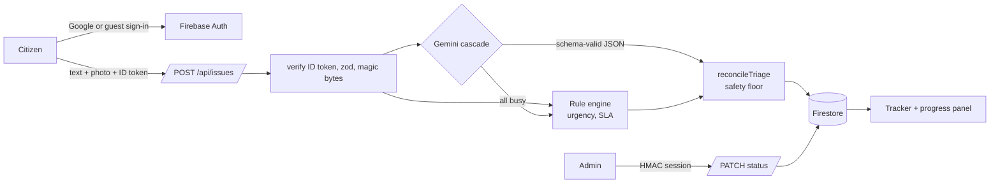

# CivicResolve

**Report. Track. Resolve.** CivicResolve lets citizens report potholes, overflowing bins, dark
streetlights, water leaks and other civic problems in under a minute. Google Gemini reads each
complaint (and its photo), picks the category, urgency and responsible department, and every issue
then moves through a public, auditable pipeline from _Reported_ to _In Progress_ to _Resolved_.

[](https://github.com/Harsha-code-per/CivicResolve/actions/workflows/ci.yml)
[](https://github.com/Harsha-code-per/CivicResolve/actions/workflows/codeql.yml)


**Live app (Google Cloud Run):** https://civicresolve-63601254635.asia-south1.run.app

- Citizens: sign in with **Google** or **Continue as guest** (one click), then report and follow issues
  under **My reports**.
- Admin console: demo passcode `civic-admin-2026` (or an allow-listed Google account).

**Stack:** React 19, TypeScript (strict), Vite, Node 22 on **Cloud Run**, **Google Gemini**
(`@google/genai`), **Cloud Firestore**, **Firebase Authentication**, zod, jose.

## What you will see

- **Landing page:** a CSS-3D isometric city whose report pins change colour from Reported to
  Resolved, live numbers from Firestore, how it works, how Gemini is kept honest, and the live pipeline.
- **Console** with a **collapsible sidebar** (icon rail on desktop, drawer on phones):
  Overview, Report an issue, Live tracker, My reports and Admin console, in light and dark themes.

## The challenge, mapped to the product

| The challenge asks for…       | CivicResolve does it with…                                                                                                                                                                                                                                             |
| ----------------------------- | ---------------------------------------------------------------------------------------------------------------------------------------------------------------------------------------------------------------------------------------------------------------------- |
| **Citizen issue reporting**   | A form with title, description, location, optional category and optional photo. Photos are downscaled in the browser (which also strips GPS EXIF data) and verified by magic bytes on the server.                                                                      |
| **AI-powered classification** | Gemini reads the text **and the photo** and returns one of six categories as schema-validated JSON (`server/ai`). Citizens can preview the triage before filing.                                                                                                       |
| **Priority detection**        | Gemini proposes a priority by danger to life and public impact; a deterministic engine scores urgency (10–100) and sets a **safety floor**, so the model can raise a priority but never downgrade a hazard such as an exposed live wire. Each priority carries an SLA. |
| **Department recommendation** | Each category maps to one of six municipal departments, and admins can reassign.                                                                                                                                                                                       |
| **Issue tracking dashboard**  | Search and filter by status, priority and department; cards or an accessible table; a timestamped status history; a live SLA countdown ("Due in 5h", "Overdue by 3h").                                                                                                 |
| **Admin dashboard**           | Sign in with an allow-listed Google account or the passcode; either opens an HMAC-signed HttpOnly session. Then update status, priority and department with a required audit note. Invalid transitions (for example _Resolved → Reported_) are rejected.               |
| **Citizen accounts**          | Firebase Authentication with Google or a one-click guest account. The server verifies each ID token itself (signature, issuer, audience, expiry). **My reports** shows each of your complaints with a Reported → In Progress → Resolved stepper.                       |
| **Visualise progress**        | A _Progress toward resolution_ panel: resolution rate, issues open past their SLA, median time to resolve, the status pipeline, and each department's resolved share.                                                                                                  |
| **Gemini + Google Cloud**     | Gemini for triage, Cloud Run for hosting, Firestore for storage, Firebase Authentication for accounts. Without a key the app still works on its rule engine, and it always shows which engine triaged an issue.                                                        |

## How Gemini is used, and kept honest

CivicResolve follows one rule: **the engine owns the rules, Gemini owns the understanding.**

1. A pure, deterministic engine (`src/domain`) owns the status state machine, SLA hours, urgency
   scoring, analytics and the category→department map. It has no network, clock or randomness, and it
   is 100% tested.
2. **Gemini** (`server/ai`) reads the complaint and photo and proposes a category, priority, department,
   a one-line summary for the crew, and its rationale.
3. The reply must match a JSON schema **generated from the same zod schema that validates it**
   (`TRIAGE_JSON_SCHEMA`), so the model can only answer with known categories and departments.
4. `reconcileTriage` merges the two: Gemini's category, department and wording, the engine's SLA, and the
   more urgent of the two priorities.
5. Citizen text is fenced as untrusted data, and any attempt to close the fence is stripped (prompt
   injection defence).
6. A cascade keeps it fast and resilient on the free tier: an answer cache, then
   `gemini-3.5-flash-lite → gemini-3.1-flash-lite → gemini-3.8-flash`, each with a 12 s timeout and a
   one-minute cooldown after failure, and finally the rule engine.



## Evaluation map

| Criterion             | Where to look                                                                                                                                                                                                                                                                                                                                                                                                            |
| --------------------- | ------------------------------------------------------------------------------------------------------------------------------------------------------------------------------------------------------------------------------------------------------------------------------------------------------------------------------------------------------------------------------------------------------------------------ |
| **Code quality**      | [`CODE_QUALITY.md`](CODE_QUALITY.md). Pure domain layer, a storage port with two adapters, a route table (`server/routes.ts`) so each endpoint is a few lines, DI for the AI models and clocks. ESLint `strictTypeChecked` + jsx-a11y strict with complexity ≤ 8, ≤ 3 params, ≤ 60 lines per function, ≤ 200 lines per file, JSDoc on exports, knip.                                                                     |
| **Security**          | [`SECURITY.md`](SECURITY.md). Server-side Firebase ID-token verification, reporter identity kept off public records, strict CSP (no inline script or style), HSTS, COOP/CORP, same-origin checks on mutations, per-IP rate limit (spoof-resistant), body caps, zod on every input, magic-byte image checks, timing-safe HMAC sessions, prompt-injection fencing, fail-fast production config, `npm audit` clean, CodeQL. |
| **Efficiency**        | [`EFFICIENCY.md`](EFFICIENCY.md). 80.0 kB gzip first-load JS (zod kept out of the browser, Firebase Auth lazy-loaded), a CSS-only 3D scene, photos downscaled to about 200 KB before upload and served lazily from their own endpoint with immutable caching, a triage cache, model cooldowns, Firestore list limit, scale-to-zero Cloud Run.                                                                            |
| **Testing**           | [`TESTING.md`](TESTING.md). 115 Vitest tests at **100% statements, branches, functions and lines** (enforced), including property tests, real RS256 tokens for identity checks, a fake Firestore, mocked Gemini and Firebase SDKs and axe in jsdom. 15 Playwright runs (5 journeys × desktop light, desktop dark, mobile) with axe WCAG 2.2 AA under the production CSP.                                                 |
| **Accessibility**     | [`ACCESSIBILITY.md`](ACCESSIBILITY.md). Skip links, landmarks, a sidebar of real links with `aria-current`, focus moved to `<main>` on navigation, an accessible collapsible sidebar and mobile drawer, focused error alerts, live regions, native `<progress>` bars with text values, a table alternative, colour plus text for every status, reduced motion and both colour schemes.                                   |
| **Problem alignment** | The table above, plus [`PROBLEM_ALIGNMENT.md`](PROBLEM_ALIGNMENT.md), which traces each requirement to code and tests.                                                                                                                                                                                                                                                                                                   |

## Run it locally

```bash
npm ci
cp .env.example .env      # optional: add GEMINI_API_KEY from Google AI Studio
npm run build && npm start
# http://localhost:8080 (admin passcode: civic-admin-2026)
```

Without a key everything still works: triage comes from the rule engine. Without
`FIRESTORE_ENABLED=true`, issues are kept in memory.

## Development checks

| Command         | What it proves                                                                                                                         |
| --------------- | -------------------------------------------------------------------------------------------------------------------------------------- |
| `npm run check` | Prettier, ESLint with 0 warnings, `tsc` (client and server), knip, tests at 100% coverage, the production build and the bundle budget. |
| `npm run e2e`   | Playwright journeys and axe WCAG 2.2 AA on desktop and mobile, light and dark, against the production server.                          |

## Deploy to Google Cloud Run

```bash
gcloud services enable run.googleapis.com cloudbuild.googleapis.com artifactregistry.googleapis.com \
  firestore.googleapis.com secretmanager.googleapis.com
gcloud firestore databases create --location=asia-south1 --type=firestore-native
printf '%s' "$GEMINI_API_KEY" | gcloud secrets create gemini-api-key --data-file=-
gcloud run deploy civicresolve --source . --region asia-south1 --allow-unauthenticated \
  --max-instances 2 --memory 512Mi \
  --set-env-vars NODE_ENV=production,FIRESTORE_ENABLED=true,ADMIN_PASSCODE=civic-admin-2026,SESSION_SECRET=$(openssl rand -hex 32) \
  --set-secrets GEMINI_API_KEY=gemini-api-key:latest
# Sign-in: add the Firebase web-app values (and optionally ADMIN_EMAILS)
gcloud run services update civicresolve --region asia-south1 --update-env-vars \
  FIREBASE_API_KEY=...,FIREBASE_AUTH_DOMAIN=<project>.firebaseapp.com,FIREBASE_PROJECT_ID=<project>,FIREBASE_APP_ID=...
```

Enable the **Google** and **Anonymous** providers in Firebase Authentication and add the Cloud Run
domain to its authorised domains.

The service account needs `roles/run.builder` (source builds), `roles/datastore.user` (Firestore) and
`roles/secretmanager.secretAccessor` (the Gemini key). A demo stays inside the Cloud Run, Firestore and
Secret Manager free tiers.

## Project layout

```
src/domain/   pure engine: types, schemas, priority + safety floor, SLA, workflow, analytics, seed data
src/app/      shell: hash routes, shared hooks, console layout, collapsible sidebar
src/auth/     AuthService port + lazy Firebase Auth implementation, AuthProvider
src/landing/  landing page and the CSS-3D city
src/ui/       React views: overview, report form, triage inspector, tracker, my reports, admin
src/lib/      browser API client and photo downscaling
server/       Node HTTP server: config, route table, request pipeline
server/ai/    Gemini model adapter, fenced prompts, triage cascade
server/store/ storage port, in-memory and Firestore adapters
server/routes/ public and admin endpoints with shared helpers
server/lib/   admin session, Firebase ID-token verification, HTTP helpers, image validation, rate limiting, security headers
tests/        domain, server, ui and architecture tests
e2e/          Playwright journeys with axe
docs/         architecture and decision records
```

## License

MIT, see [`LICENSE`](LICENSE).
