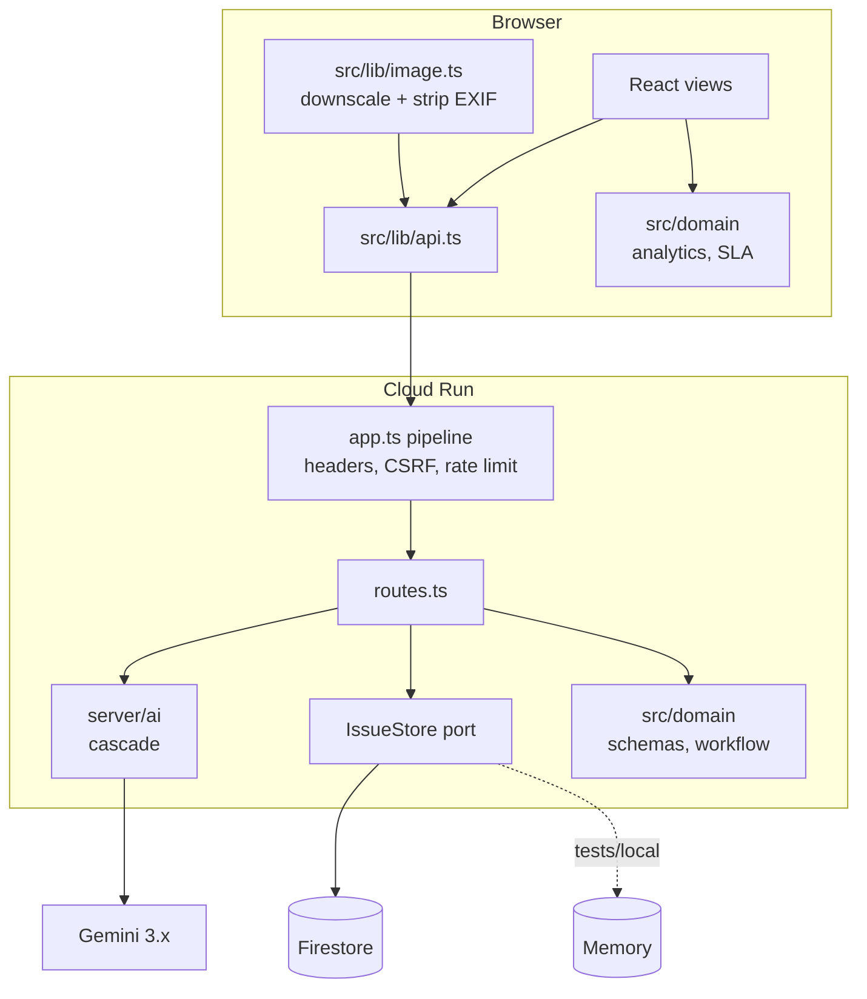

# Architecture

## Request lifecycle: filing a complaint

1. The browser downscales the photo, then POSTs JSON to `/api/issues`.
2. `app.ts` sets security headers, checks the origin and the per-IP rate limit, and finds the route.
3. The route validates the body with `createIssueSchema` and checks the photo's magic bytes.
4. `AiTriageClient.analyze` computes the rule-engine triage, then asks the Gemini cascade; the answer is
   validated with zod and merged by `reconcileTriage`.
5. `IssueStore.create` assigns `CR-2026-####` in a Firestore transaction and stores the photo separately.
6. The response returns the issue and its triage; the tracker updates immediately.

## Decisions

- [ADR 0001: The engine owns the rules, Gemini owns the understanding](adr/0001-engine-owns-rules.md)
- [ADR 0002: A resilient Gemini cascade](adr/0002-gemini-cascade.md)
- [ADR 0003: Firestore behind a storage port](adr/0003-firestore-storage-port.md)
- [ADR 0004: A single Node service on Cloud Run](adr/0004-single-service-cloud-run.md)
